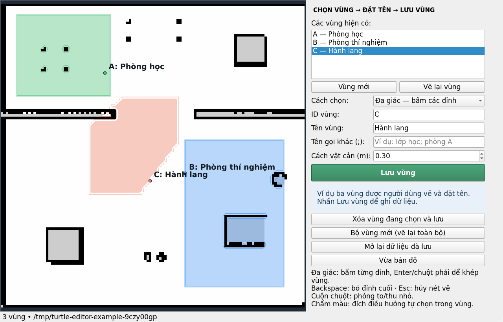

# Chọn vùng trên bản đồ, đặt tên và lưu

Bộ vùng hiện tại do người dùng lưu gồm **A, B, C, D**, tên lần lượt cũng là
A, B, C, D. C ở phía trên; A ở dưới bên trái; B ở dưới bên phải; D ở giữa.
`generated/regions.yaml` và `generated/labels.npy` là nguồn dữ liệu chính;
`seeds.yaml` chỉ là các điểm tham khảo lấy từ đích hiện tại, không tái tạo
được chính xác đường biên đa giác người dùng vẽ.

Luồng chính là **vẽ vùng → nhập tên → nhấn Lưu vùng**. Giao diện desktop PyQt5
hiển thị bản đồ thật và các vùng đã lưu. Không cần Gazebo hoặc Nav2 đang chạy
để tạo vùng từ bản đồ đã có.



## Mở giao diện

```bash
cd ~/turtle
source /opt/ros/humble/setup.bash
sudo apt install python3-pyqt5
colcon build --symlink-install --packages-select robot_node
source install/setup.bash

ros2 run robot_node map_partitioning \
  --map src/Turtlebot4/robot_navigation/maps/my_map.yaml \
  --output 'src/Turtlebot4/Map Partitioning/generated'
```

Lệnh trên mặc định mở giao diện vẽ tay. Có thể dùng executable tương đương
`ros2 run robot_node map_region_editor` với cùng `--map`, `--output` và
`--clearance 0.30`.

## Thao tác

1. Nếu thư mục đã có `regions.yaml` và `labels.npy`, giao diện mở lại các vùng
   hiện có. Muốn vẽ lại toàn bộ bản mẫu, nhấn **Bộ vùng mới (vẽ lại toàn bộ)**.
   Dữ liệu trên đĩa được giữ tới khi bạn lưu vùng đầu tiên của bộ mới.
2. Chọn cách vẽ:
   - **Đa giác:** bấm từng đỉnh trên bản đồ; nhấn Enter, chuột phải hoặc nhấp
     đúp đỉnh cuối để khép vùng.
   - **Hình chữ nhật:** giữ chuột trái và kéo từ một góc sang góc đối diện.
3. Nhập **ID vùng** (A, B, C…), **Tên vùng** (Phòng học, Phòng thí nghiệm…)
   và tùy chọn các **Tên gọi khác**, ngăn cách bằng dấu `;`.
4. Nhấn **Lưu vùng**. Thông báo `Đã lưu vùng ...` xác nhận đã ghi file thật.
5. Nhấn **Vùng mới** và lặp lại cho các vùng tiếp theo. Tạo tối thiểu ba vùng
   để thử demo giọng nói ban đầu.

Cuộn chuột để phóng to/thu nhỏ; nút **Vừa bản đồ** đưa về toàn bộ bản đồ.
Khi vẽ đa giác, Backspace bỏ đỉnh cuối và Esc hủy nét đang vẽ.

Để sửa vùng, chọn nó trong danh sách, sửa tên/aliases rồi **Lưu vùng**.
Chọn **Vẽ lại vùng** nếu muốn thay đường biên. Nút **Xóa vùng đang chọn và
lưu** xóa vùng đó và cập nhật file, nhưng không cho xóa vùng cuối cùng vì
catalog điều hướng cần ít nhất một vùng. **Mở lại dữ liệu đã lưu** khôi phục
bộ vùng trên đĩa nếu bạn đã làm trống danh sách nhưng chưa lưu bộ mới.
Nét vẽ và nội dung ô nhập chưa nhấn Lưu vùng sẽ không tự ghi khi đóng cửa sổ.

## Quy tắc lưu

- Chỉ các ô trống nằm trong hình đã chọn được gắn nhãn. Vùng không lan ra
  ngoài hình. Vật cản và ô unknown theo ngưỡng map YAML được loại khỏi vùng.
- Các vùng không được chồng nhau trên ô trống; khi vẽ hai vùng kề nhau, tránh
  dùng chung hàng/cột ô trên biên. Có thể phóng to để chọn chính xác.
- ID, tên và aliases phải phân biệt được sau khi bỏ dấu/chữ hoa/thường để
  parser giọng nói không nhận nhầm. ID dùng chữ, số, `_`, `-`, bắt đầu bằng chữ.
- Vùng phải có ô đích đạt khoảng cách tới vật cản tối thiểu (mặc định 0,30 m).
  Vùng mới chọn ô trống an toàn gần tâm đa giác nhất; nếu tâm rơi vào vật cản
  thì chiếu về ô đạt clearance gần nhất. Chính sách được lưu trong goal_policy
  và được giữ khi đổi tên. A/B hiện dùng center; C/D giữ chính sách cũ
  max_clearance để không đổi các đích ngoài yêu cầu. Chấm màu trên giao diện là đích đó.
- Không lưu đa giác tự cắt, vùng quá nhỏ, tên rỗng, tên/alias trùng hoặc vùng
  không có đích an toàn. Khi lỗi, file đã lưu trước đó được giữ.
- Hình vẽ có thể bao quanh các phần trống không nối nhau. Nav2 tiếp tục kiểm
  tra đường đi từ vị trí robot đến đích; bản vẽ không bảo đảm khả năng đi tới.

Mỗi lần Lưu vùng thành công cập nhật ba file:

| File | Nội dung |
| --- | --- |
| `regions.yaml` | ID, tên, aliases, goal x/y/yaw, đường biên và các đỉnh người dùng vẽ |
| `labels.npy` | Nhãn ô: 1..N theo thứ tự regions; 0 là ô chưa gắn vùng |
| `partition_preview.png` | Ảnh xem trước có nhãn và điểm đích |

Thay ảnh, resolution, origin hoặc ngưỡng bản đồ thì cần tạo bộ vùng cho map
mới. Giao diện kiểm tra fingerprint trước khi mở lại dữ liệu. Nếu bạn đang
mở map mới, chọn thư mục output mới thay vì đọc nhầm vùng của map cũ.

## Dùng vùng đã lưu để điều khiển giọng nói

Sau khi lưu xong, node `voice_navigation` đọc lại catalog trước hành trình
mới và cập nhật markers RViz, gồm xóa các marker cũ. Hành trình đang chạy
tiếp tục với bộ vùng đã dùng khi bắt đầu; thay đổi được áp dụng sau khi hoàn
tất hoặc hủy hành trình. Whisper cũng tự đọc tên/ID trước mỗi lượt nhận dạng.
Giữ map của localization giống map được chọn trong giao diện.

```bash
ros2 launch robot_node voice_navigation.launch.py \
  regions_file:="$PWD/src/Turtlebot4/Map Partitioning/generated/regions.yaml" \
  rviz:=true
```

Sau khi simulation/localization/Nav2 active, nói tên bạn đã đặt, ví dụ
`Go to area D` hoặc `Go from area A via area D then to area B`. Whisper
mặc định language:=en; có thể chọn language:=vi nếu muốn nói tiếng Việt.
Xem hướng dẫn khởi động robot và Whisper ở `../Voice-Controlled/README.md`.

## Chế độ dòng lệnh tùy chọn

Vẫn có thể tạo vùng theo seeds cũ:

```bash
ros2 run robot_node map_partitioning \
  --map src/Turtlebot4/robot_navigation/maps/my_map.yaml \
  --seeds 'src/Turtlebot4/Map Partitioning/seeds.yaml' \
  --output /tmp/turtle-seed-regions
```

Hoặc thử phân vùng tự động bằng morphology và khoảng cách geodesic:

```bash
ros2 run robot_node map_partitioning --auto \
  --map src/Turtlebot4/robot_navigation/maps/my_map.yaml \
  --output /tmp/turtle-auto-regions \
  --opening-radius 0.4 --min-area 0.5 --clearance 0.30
```

Không truyền `--seeds` hoặc `--auto` sẽ mở giao diện. `seeds.yaml` chỉ được
sử dụng trong chế độ seeds; cách vẽ tay không cần chỉnh file này.

## Mã nguồn và kiểm tra

- `robot_node/robot_node/map_region_editor.py`: giao diện và thao tác chuột.
- `robot_node/robot_node/region_editor_model.py`: kiểm tra hình vẽ và vùng.
- `robot_node/robot_node/partition_io.py`: xuất dữ liệu đã kiểm tra trước khi thay file.
- `robot_node/robot_node/semantic_map.py`: bản đồ, hình học và catalog giọng nói.

Đã kiểm tra thao tác chuột thật qua Qt offscreen cho đa giác, hình chữ nhật,
phóng to, lưu, đổi tên và mở lại; kiểm tra dữ liệu vùng, vị trí goal, tên trùng,
chồng lấn và giữ file cũ khi lỗi lưu. Toàn bộ package: **230 tests đạt**.
